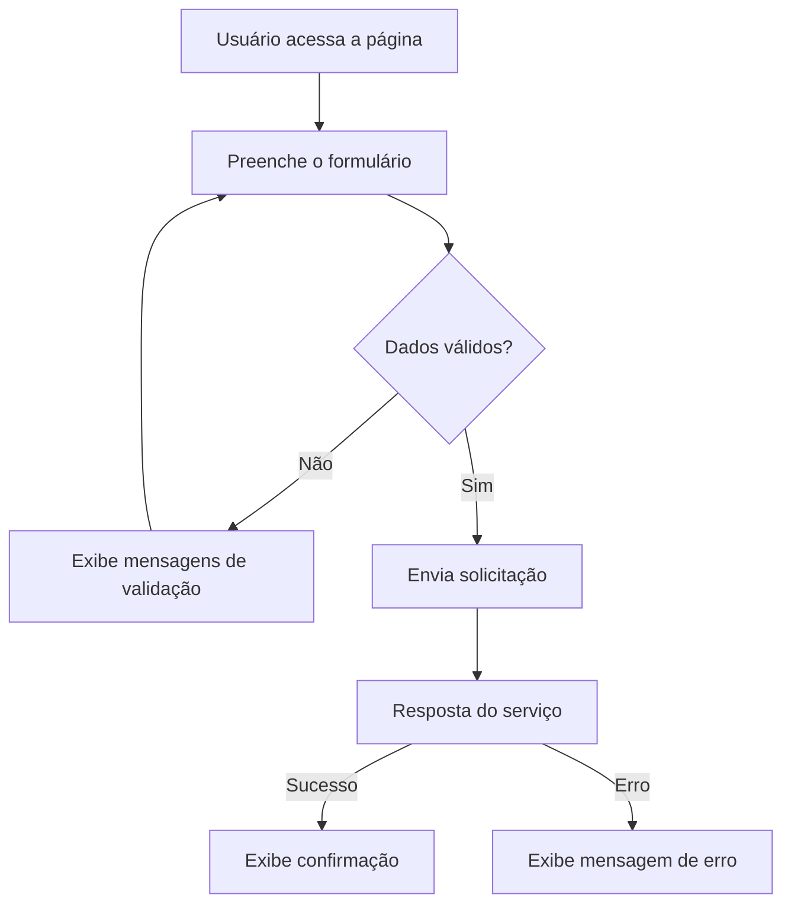

# Skill: Reverse Engineering de Sites

## Objetivo

Investigar um site ou aplicação web existente e produzir uma documentação técnica que permita compreender e, quando solicitado, reproduzir sua interface e seus comportamentos com fidelidade.

A análise deve ser baseada em evidências observáveis: páginas acessíveis, DOM, estilos, recursos estáticos, interações, requisições de rede e comportamento em diferentes tamanhos de tela. Não invente informações que não possam ser verificadas.

## Limites e autorização

- Analise somente sites públicos, ambientes de teste ou sistemas para os quais o usuário tenha autorização explícita.
- Não tente contornar autenticação, paywalls, controles de acesso, CAPTCHA, WAF ou mecanismos de proteção.
- Não explore vulnerabilidades, não extraia dados pessoais e não colete credenciais, tokens, cookies ou segredos.
- Não execute ações destrutivas, transações reais, envios definitivos ou alterações de dados em sistemas de terceiros.
- Não copie código proprietário, conteúdo protegido ou identidade visual de forma enganosa. Quando o objetivo for criar uma implementação, use a análise como referência funcional e implemente código original.
- Se uma etapa depender de acesso autenticado, solicite ao usuário um ambiente autorizado ou evidências fornecidas por ele. Nunca peça senhas ou tokens no chat.

## Gatilhos de ativação

Ative esta skill quando o usuário solicitar, por exemplo:

- Fazer engenharia reversa de um site ou sistema.
- Entender como uma página foi construída.
- Mapear telas, componentes, navegação ou funcionalidades.
- Documentar um site de referência antes de desenvolver outro.
- Reproduzir uma interface com base em um site existente.
- Identificar tecnologias, padrões visuais, responsividade ou integrações observáveis.
- Criar uma especificação técnica a partir de uma aplicação em funcionamento.

## Princípios de trabalho

- **Evidência antes de conclusão:** diferencie fatos observados, inferências e pontos não verificados.
- **Cobertura por fluxo:** não analise somente a página inicial; percorra as rotas e jornadas relevantes.
- **Fidelidade funcional:** registre estados, validações, feedbacks, carregamentos, erros e transições.
- **Fidelidade visual:** documente layout, dimensões relativas, tipografia, cores, espaçamentos, ícones e comportamento responsivo.
- **Não presumir backend:** uma requisição observada não revela, por si só, a implementação interna do servidor.
- **Reprodutibilidade:** registre URL, viewport, estado inicial e passos necessários para repetir cada observação.
- **Escopo incremental:** priorize as páginas e jornadas mais importantes para o objetivo informado pelo usuário.

## Fluxo de execução

### Etapa 1 — Definir o escopo

Antes de iniciar, identifique:

- URL base e domínio autorizado.
- Objetivo da análise: documentação, redesign, migração ou reprodução funcional.
- Páginas, módulos ou jornadas que precisam ser investigados.
- Se há acesso autorizado a áreas autenticadas.
- Navegadores e resoluções relevantes, quando especificados.
- Profundidade esperada: visão geral, análise detalhada ou especificação para implementação.

Se faltar uma informação essencial que impeça o início, faça uma pergunta objetiva. Caso contrário, comece pela área pública e registre as limitações.

### Etapa 2 — Inventário de páginas e navegação

Construa um inventário contendo:

| Campo | O que registrar |
| --- | --- |
| Página | Nome funcional da página |
| URL/rota | Caminho observado |
| Acesso | Público, autenticado ou não verificado |
| Objetivo | O que o usuário faz nessa página |
| Entrada | Como chegar à página |
| Saídas | Links, ações e destinos |
| Prioridade | Alta, média ou baixa |
| Estado | Analisada, parcial ou pendente |

Investigue:

- Cabeçalho, navegação principal, menu lateral e rodapé.
- Links internos, breadcrumbs, abas e navegação contextual.
- Rotas diretas e comportamento ao atualizar a página.
- Estados de página vazia, carregamento, erro e conteúdo.
- Redirecionamentos e parâmetros de URL observáveis.

Não marque uma rota como analisada apenas porque ela foi encontrada no menu. Abra-a e verifique seu conteúdo.

### Etapa 3 — Inspeção visual e estrutura da interface

Para cada página prioritária, registre:

- Viewport utilizado e dimensões da página.
- Estrutura geral: header, sidebar, conteúdo, colunas, painéis e footer.
- Hierarquia de títulos e textos.
- Tipografia observável: família provável, pesos, tamanhos e line-height.
- Cores, fundos, bordas, sombras, raios e estados visuais.
- Grid, largura máxima, alinhamentos, margens e espaçamentos.
- Ícones, imagens, logotipos e demais assets.
- Componentes reutilizados entre páginas.
- Diferenças entre desktop, tablet e mobile.

Quando possível, utilize screenshots e inspeção do DOM/CSS. Não deduza medidas exatas apenas pela aparência de uma captura: indique quando forem estimadas.

### Etapa 4 — Inspeção de componentes e interações

Interaja com os elementos de forma segura e documente:

- Botões, links, menus, dropdowns e modais.
- Formulários, campos obrigatórios, máscaras e validações.
- Abas, filtros, ordenação, busca e paginação.
- Uploads, seletores, calendários e controles especiais.
- Estados hover, focus, active, disabled e loading.
- Mensagens de sucesso, alerta, confirmação e erro.
- Confirmações antes de ações importantes.
- Comportamento ao cancelar, fechar ou voltar.

Para cada interação, use o seguinte formato:

| Item | Descrição |
| --- | --- |
| Elemento | Nome ou identificação visual |
| Estado inicial | Como aparece antes da ação |
| Ação | Clique, digitação, seleção etc. |
| Resultado | Alteração observada |
| Validações | Regras e mensagens |
| Estado final | Como a interface fica |
| Evidência | Screenshot, rota ou observação |

Não conclua operações reais em sistemas externos. Use somente ações reversíveis e seguras, ou interrompa antes da confirmação final.

### Etapa 5 — Inspeção técnica do frontend

Quando houver ferramentas e autorização, examine:

- HTML/DOM e hierarquia dos elementos.
- Classes CSS, estilos computados e variáveis CSS.
- Scripts e bibliotecas identificáveis por evidências públicas.
- Fontes, imagens, SVGs e demais arquivos estáticos.
- Metadados, manifest, favicon e configurações públicas.
- Estratégias aparentes de layout e responsividade.
- Erros de console relevantes para o funcionamento observado.

A identificação de frameworks ou bibliotecas deve ser tratada como hipótese quando não houver evidência conclusiva. Não tente acessar arquivos internos, sourcemaps privados ou diretórios não expostos publicamente por meios de contorno.

### Etapa 6 — Inspeção de rede e integrações

Com as ferramentas de desenvolvedor do navegador, observe somente o tráfego necessário para entender o comportamento:

- Método HTTP e endpoint chamado.
- Momento em que a chamada ocorre.
- Parâmetros não sensíveis.
- Estrutura geral da resposta, removendo dados pessoais.
- Status HTTP e comportamento em caso de falha.
- Dependências de serviços externos.
- Paginação, filtros e ordenação, quando observáveis.

Nunca registre ou reproduza: cookies, Authorization headers, tokens, chaves de API, senhas, dados pessoais ou identificadores sensíveis. Remova esses valores de screenshots, logs e documentação.

Não afirme conhecer o banco de dados, a arquitetura interna ou as regras do servidor sem evidência direta. Descreva apenas o contrato observado entre navegador e serviço.

### Etapa 7 — Modelagem dos fluxos

Represente as jornadas principais em passos numerados ou Mermaid.

Exemplo:



Para cada fluxo, registre pré-condições, passos, decisões, resultado esperado, erros possíveis e pontos ainda não verificados.

### Etapa 8 — Avaliação de responsividade e acessibilidade

Verifique, quando aplicável:

- Desktop, tablet e mobile.
- Menu colapsável e navegação por toque.
- Overflow horizontal e elementos cortados.
- Reorganização de colunas, cards, tabelas e formulários.
- Contraste, foco visível e navegação por teclado.
- Labels e nomes acessíveis de controles.
- Hierarquia de headings e textos alternativos.
- Alvos de toque e mensagens de validação compreensíveis.

Não declare conformidade WCAG sem uma avaliação suficiente. Liste problemas observados e recomendações.

### Etapa 9 — Consolidar achados

Classifique cada achado:

- **Confirmado:** observado diretamente.
- **Inferido:** conclusão provável baseada em evidências, ainda não confirmada.
- **Não verificado:** informação indisponível ou bloqueada.
- **Recomendação:** proposta para a implementação futura.

Priorize problemas e requisitos por impacto:

- **P0 — Bloqueador:** impede uma jornada essencial.
- **P1 — Alto:** compromete significativamente o uso.
- **P2 — Médio:** causa atrito ou inconsistência.
- **P3 — Baixo:** melhoria visual ou detalhe secundário.

### Etapa 10 — Preparar documentação para implementação

Se o objetivo for reconstruir a aplicação, converta os achados em requisitos implementáveis:

- Mapa de rotas.
- Inventário de telas.
- Biblioteca de componentes.
- Tokens visuais.
- Regras de interação e validação.
- Contratos de API observados.
- Estados de interface.
- Requisitos responsivos e de acessibilidade.
- Critérios de aceite por tela e fluxo.
- Dúvidas e dependências que precisam ser confirmadas.

Não escolha uma tecnologia para a reconstrução sem considerar o projeto de destino. Primeiro inspecione sua estrutura, dependências, padrões e convenções existentes.

## Estrutura recomendada da documentação

Crie a pasta `reverse-engine/` na raiz do projeto analisado. Mantenha a documentação principal em `reverse-engine/README.md`.

Quando o escopo justificar, a documentação pode ser dividida em arquivos complementares:

```text
reverse-engine/
├── README.md
├── pages.md
├── components.md
├── user-flows.md
├── visual-system.md
├── integrations.md
├── assets.md
└── findings.md
```

Se o usuário pedir somente um arquivo Markdown, concentre todo o conteúdo em `reverse-engine/README.md`, usando títulos e tabelas. Não crie arquivos extras sem necessidade.

## Modelo obrigatório do README.md

O arquivo principal deve conter:

### Visão geral

- Nome do site/sistema.
- URL analisada.
- Objetivo da engenharia reversa.
- Data da análise.
- Escopo e limitações.

### Resumo executivo

- O que o sistema faz.
- Principais módulos.
- Características relevantes da interface.

### Tecnologias identificadas

| Tecnologia | Evidência | Grau de confiança | Observações |
| --- | --- | --- | --- |
|  |  |  |  |

### Mapa de páginas e rotas

| Rota | Finalidade | Acesso | Status da análise |
| --- | --- | --- | --- |
|  |  |  |  |

### Análise das telas

Estrutura, componentes, conteúdo, estados e responsividade.

### Sistema visual

Cores, tipografia, espaçamentos, bordas, sombras, ícones e padrões.

### Componentes reutilizáveis

| Nome | Finalidade | Propriedades observáveis | Estados |
| --- | --- | --- | --- |
|  |  |  |  |

### Fluxos do usuário

Passos, decisões, validações, respostas e exceções.

### Integrações e rede

| Endpoint | Método | Finalidade | Formato geral |
| --- | --- | --- | --- |
|  |  |  |  |

Não incluir credenciais ou dados sensíveis.

### Assets

| Nome/caminho público | Tipo | Uso | Observações de licença |
| --- | --- | --- | --- |
|  |  |  |  |

### Responsividade e acessibilidade

Comportamentos por viewport e problemas encontrados.

### Achados e recomendações

| Achado | Evidência | Impacto | Prioridade | Recomendação |
| --- | --- | --- | --- | --- |
|  |  |  |  |  |

### Requisitos para reconstrução

Requisitos funcionais, visuais e técnicos. Critérios de aceite.

### Pendências e pontos não verificados

O que não foi possível confirmar e por quê.

### Checklist de conclusão

Itens efetivamente analisados, sem marcar como concluído o que não foi verificado.

## Checklist de qualidade

Antes de finalizar, confirme:

- [ ] O escopo e as limitações estão documentados.
- [ ] As rotas prioritárias foram abertas e verificadas.
- [ ] Os principais componentes foram inventariados.
- [ ] Os fluxos críticos foram percorridos.
- [ ] Estados de sucesso, erro, vazio e carregamento foram considerados.
- [ ] A responsividade foi avaliada nos viewports relevantes.
- [ ] As integrações foram descritas sem dados sensíveis.
- [ ] Fatos, inferências e pendências estão diferenciados.
- [ ] Recomendações estão ligadas a evidências.
- [ ] A documentação permite que outra pessoa entenda o sistema sem depender da análise original.

## Comportamento esperado do agente

- Trabalhe de forma metódica e incremental.
- Não faça alterações no site analisado.
- Não implemente uma cópia antes de concluir o inventário mínimo.
- Não invente endpoints, componentes, regras de negócio, tecnologias ou medidas.
- Se não conseguir observar algo, registre como “não verificado”.
- Ao encontrar uma limitação de acesso, pare nessa etapa e explique o que é necessário para continuar.
- Ao concluir, apresente um resumo do que foi analisado, os arquivos criados e as principais lacunas.
